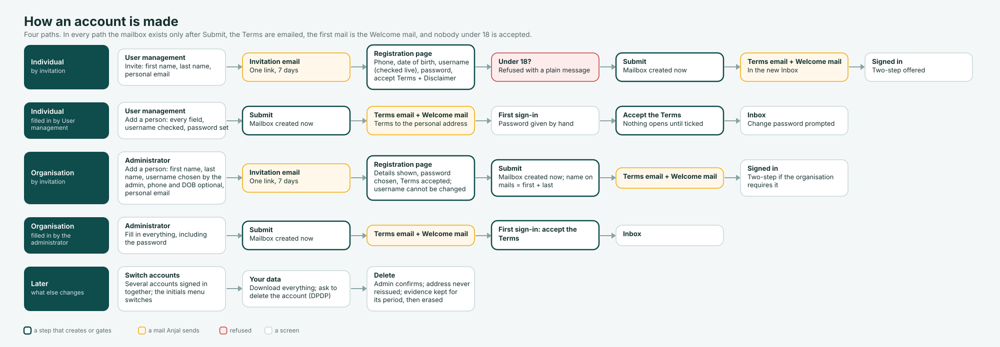

# Accounts and sign-up (rc.22) - design record

Decided with the owner on 18 October 2026, from the rc.22 flow chart and the
38 accepted mockups. This is the record the code follows; Help > "How an
account is made" says the same in the words on the screen.

The picture: `account-flows.svg` beside this file, and served by the webmail
at `/help/account-flows.svg` for the help article.

## Rules

1. **Nobody under 18.** The date of birth is asked once (required for
   individuals, optional for organisations' people), checked against today,
   and refused with a plain message. It is kept on the profile and never
   shown on mail. (`MailboxService.AgeProblem`, `MinimumAge = 18`.)
2. **Fields:** first name, last name, phone (recorded now, verified in a
   later release), date of birth, personal email address (the Terms, the
   Welcome mail and password resets go there).
3. **Individual accounts** are made only through the `usermanagement`
   account of the individuals' tenant on anjalmail.com (`TenantKind`
   document, `Individuals = true`). An individual account is never moved
   into an organisation; an organisation's person is never an individual.
4. **Organisation accounts** are made only by that organisation's
   administrator, who chooses the username. Individuals choose their own
   (checked live at `/auth/username`).
5. **The mailbox exists only on Submit.** Until then an invitation is a
   `PendingInvitation` document (one link, 7 days, usable once); the
   operator or administrator can withdraw it.
6. **The Terms are emailed** the moment the account is made, and accepted
   either on the registration page or - when an administrator filled the
   account in - at first sign-in, before anything else opens
   (`SignInDemandAsync` answers `terms` first; `/terms/accept`). The
   accepted version is on the profile (`TermsVersion`), so a changed text
   is asked for again.
7. **The first mail is the Welcome mail** (from `welcome@<domain>`).
8. **Name on mails:** an organisation's default is first + last; the
   administrator may allow nicknames (`OrgMailPolicy.Nicknames`); individuals
   may use nicknames.
9. **Forwarding:** by rule only (`MailRule.ForwardTo`); always a copy, never a
   move; individuals anywhere, organisations only when the administrator
   allows forwarding outside (`OrgMailPolicy.ForwardingOutside`); a rule can
   be applied to older mail (up to 200). `X-Anjal-Forwarded` counts hops;
   three at most.
10. **Several accounts together:** up to five in one browser
    (`anjal.accounts` cookie, data-protected); the account menu switches;
    "Sign out of this account" and "Sign out of all".
11. **Your data (DPDP):** download everything (zip: every message as .eml,
    contacts, rules, profile, activity, README; ready for 7 days), and ask
    to delete. The administrator confirms; the address is retired for ever
    (`retired` tenant document); evidence stays for its legal period.

## The four paths

| Path | Who starts it | What they type | Then |
|---|---|---|---|
| Individual, invited | usermanagement | first, last, personal email | registration page: phone, DOB, username (live check), password, Terms + Disclaimer ticked; Submit makes the mailbox |
| Individual, filled in | usermanagement | everything, including a password given by hand | Terms email to the personal address; first sign-in: accept the Terms, then change the password |
| Organisation, invited | administrator | first, last, **username**, personal email; phone and DOB optional | registration page shows the details; password chosen; username fixed |
| Organisation, filled in | administrator | everything, including the password | first sign-in: accept the Terms |

## Domains

- `anjal.co.in`: the product and the maintainer (`arun@anjal.co.in`,
  webmail at `mail.anjal.co.in`).
- `anjalmail.com` (`ANJAL_SHARED_DOMAIN`): individuals' addresses
  (`priya@anjalmail.com`), and every organisation's automatic subdomain
  (`sgh.anjalmail.com`) made when the organisation is created, beside any
  domain it brings. The wildcard MX receives for the subdomains.
- An organisation's own domain (`sgh.in`) is Zoho-style: its MX, SPF and
  DKIM point at Anjal and mail arrives natively.

## Sign-in page

Ten designs (`SignInDesigns`), the organisation's colour (`--org`), logo,
background picture (designs 1, 5 and 7), welcome line and help line
(`Branding`). Only the frame changes: the form inside `AuthFrame` is always
Anjal's, so a page can never be made to steal passwords.

## Reserved usernames

`postmaster`, `abuse`, `unsubscribe`, `noreply`, `no-reply`, `anjal`,
`usermanagement`, `welcome`. The operator may still name the individuals'
tenant's administrator `usermanagement`; nobody else may take it.

## Legal text

`LegalText.cs` holds the Terms of Use and the Disclaimer with a `Version`;
`docs/legal/terms-draft-2026-10-18.md` is the same text with the questions
for the lawyer. Change the text and the version together.
